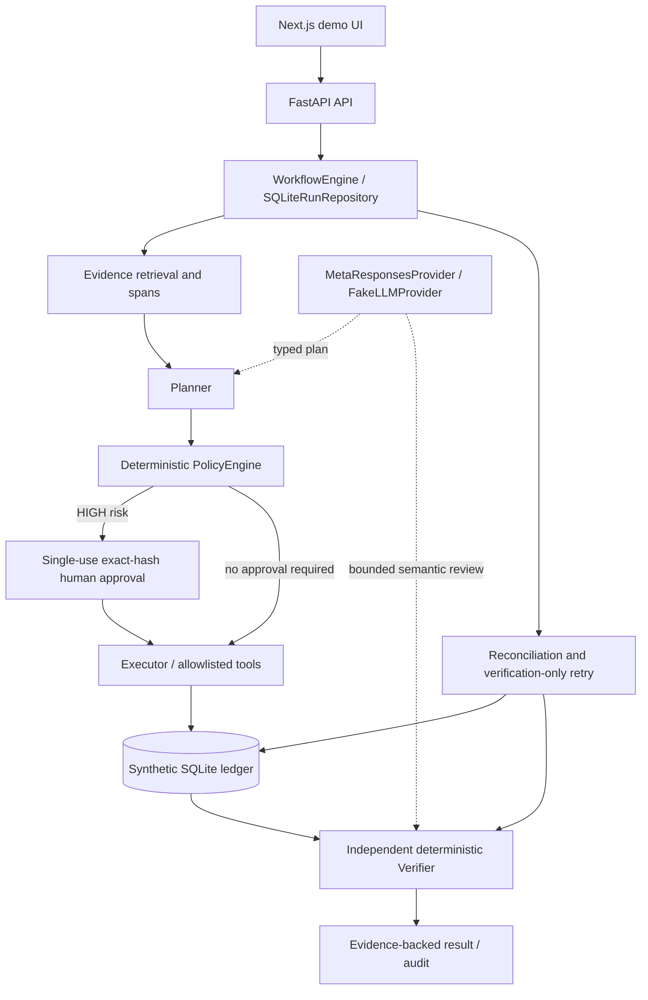

# TrustFlow — Verifiable AI Agent Workflows

> **AI can propose. Humans authorize. Evidence proves.**
>
> An AI agent's success message is not proof that an action was authorized, executed once, or verified after a timeout. TrustFlow connects an **exact approved plan**, a **stable operation identity**, and **independent ledger evidence** across uncertain execution.

**Built for the Meta Global AI Developer Hackathon 2026 · Push the Frontier.**

TrustFlow is an open-source, local research-and-engineering prototype for **auditable agent workflows with synthetic financial operations**. It combines Meta Muse planning and semantic review with deterministic policy enforcement, hash-bound human approval, idempotent execution, persistent state, and ledger-grounded verification.

**Scope:** all balances and transfers are synthetic. This is **not** a production banking system, a payment integration, or a general distributed exactly-once guarantee.

[Watch the demo on YouTube](https://www.youtube.com/watch?v=QnLXbL9yXHM) · [Architecture](#architecture) · [Meta integration](#built-with-meta-powered-by-meta) · [Development usage](#ai-assisted-development-usage) · [Measured results](#measured-results-and-evidence) · [Quickstart](#reproduce-the-offline-demo) · [Safety boundaries](#security-and-limitations) · [Archived demo](docs/submission/video/trustflow-demo.mp4)

## The problem

A worker can commit a transaction **after its caller times out**. If an agent retries the action just because it did not receive a success response, it may cause a second transfer. Likewise, an approval of one plan must not silently authorize a different plan after re-planning.

TrustFlow demonstrates a bounded way to answer three questions with inspectable evidence:

1. **Was this exact action authorized?** A human decision binds to the version and SHA-256 hash of a specific plan snapshot.
2. **What actually executed?** Backend-owned operation identities and SQLite idempotency associate approved intents with committed synthetic transfers.
3. **Can we independently establish the outcome?** Verification reads ledger state instead of trusting a model's or tool's success message; recovery checks the original operation rather than replaying the mutation.

## Built with Meta. Powered by Meta.

**Built with Meta Muse Code.** The project developer credits Meta Muse Code as an extensive AI-assisted engineering collaborator for architecture, typed workflows and tools, retrieval/evidence, persistence, user interface, evaluation, testing, and iterative reliability remediation. **Codex** also contributed fixes and independent reviews. The human developer directed requirements, final decisions, and authorization. This attribution does not imply Muse exclusively authored every commit. See the [development worklog](docs/worklog.md).

**Powered by Meta Model API.** A typed [`MetaResponsesProvider`](src/trustflow/llm/provider.py) uses `POST https://api.meta.ai/v1/responses` with strict structured-output schemas for planning and semantic review:

| Model | Role | Verified M5.5 scope |
|---|---|---|
| **Muse Spark 1.3** (`muse-spark-1.3`) | Generates typed plans and, in the tested profiles, reviews bounded workflows | **10 real calls** in a bounded local session; **5/5** Spark matrix cases passed |
| **Muse Wonder 1.0** (`muse-wonder-1.0`) | Configurable higher-capability planner/reviewer | **1 real semantic-review call**, on a prepared synthetic recovery scenario whose plan came from an **offline fixture** |
| **FakeLLMProvider** | Deterministic replay, fault injection, reproducible offline acceptance | Used for the browser demo's approval, timeout, and SIGKILL interaction scenarios |

The model **proposes** structured steps and may **review** goal/evidence consistency. It does **not** decide final risk, approve payments, own an idempotency key, or override independent deterministic verification. The application validates returned tool names, arguments, schemas and preconditions before execution; invalid live responses fail closed, without silently switching to fake mode.

### M5.5 real API evidence — November 4, 2026

A separately authorized, bounded local run used the exact application source [`aacfed074a4116dbded98ee88f783226a910e55c`](https://github.com/IvanRomanteev/TrustFlow/tree/aacfed074a4116dbded98ee88f783226a910e55c):

| Measure | Reported outcome |
|---|---|
| Real calls | **11 total: 10 Spark + 1 Wonder** |
| HTTP/provider status | 11 × **HTTP 200 / completed**, response model identities checked; no transport retries or repairs |
| Spark scenario matrix | **5/5**: read, approved synthetic transfer, rejected transfer, recovery, and semantic-negative case |
| Wonder | **One semantic recovery review**; no live Wonder planning or full mixed-model matrix |
| Usage | 11,042 input tokens + 11,299 output tokens |
| Estimated API cost | **$0.073201** (estimate, not an invoice), within a $0.33 authorized advisory budget |
| Test configuration | `max_output_tokens=4096`, `reasoning.effort=low`; bounded attempts and isolated synthetic storage |

The local M5.5 package contains sanitized call-level records, model identity checks, independent SQLite observations and plan-hash → operation → transaction bindings. In the Spark matrix, the approved synthetic transfer was **$1,500** and the recovered synthetic transfer **$1,200**, with original operation identities preserved. The Spark recovery case deliberately replaced the first real review result with `INVALID`, then counted a separate verification-only retry; it does not demonstrate a naturally occurring provider outage. The live harness used **automated fixture approvals**; an interactive human approval is demonstrated separately in **OFFLINE / FAKE MODE**.

**Evidence status:** the results above are supported by the locally produced M5.5 reports, but the full M5.5 evidence bundle has **not been published in this repository** and is **not an independently accepted full milestone**. One Wonder review is *not* proof of a Wonder-planned end-to-end workflow. A prior live recovery failure is retained in the local historical evidence; the later bounded success does not erase it. The older, [public M5.3 Spark read-only diagnostic](docs/submission/m53-live-results.md) is **historical**, not the current limit of live integration.

## AI-assisted development usage

TrustFlow was engineered through an intensive developer-directed, AI-assisted workflow. **The developer credits Meta Muse Code as a major engineering collaborator**, while OpenAI Codex also contributed implementation work and independent reviews. The developer retained responsibility for architecture choices, risk boundaries, acceptance criteria, publication and final decisions.

The developer reports the following **account-level aggregate metrics** from a **Meta Model API Usage dashboard** screenshot provided on **November 4, 2026**. These figures are developer-supplied; no account export or original screenshot was independently inspected for this README update:

| Dashboard metric | Displayed value | Interpretation |
|---|---:|---|
| **Input tokens** | **320.6 million** | Total processed input context as reported by the dashboard, including cached and repeatedly submitted context |
| **Output tokens** | **1.9 million** | Model output tokens across the dashboard's selected scope |
| **Requests** | **~3,500** | Aggregate requests, shown rounded as `3.5k` |
| **Input cache hit rate** | **93.2%** | Dashboard-reported cache reuse rate; not a measure of novel reasoning or code generation |

This is approximately **322.5 million input + output tokens reported**, **not 322.5 million unique tokens written**, and **not an amount paid in USD**. Repeated context and prompt caching can account for much of the input total. According to the supplied description, the screenshot's charts show late-October dates (including October 24–31), but the precise account filters and the complete selected date range are not established. The metrics therefore **must not be attributed exclusively to TrustFlow, Muse Code, Muse Wonder, one model, or the entire hackathon period** without more granular export data.

These **account-level dashboard totals** are separate from the **11 bounded runtime API calls** and measured token/cost usage reported in [M5.5 real API evidence](#m55-real-api-evidence--november-4-2026). Likewise, they are separate from the independent offline test suite. They provide context about the scale of AI-assisted development, **not a benchmark of model quality, engineering productivity, code authorship or system reliability**.

*Source: developer-provided dashboard figures and screenshot description supplied November 4, 2026. The screenshot is not stored in this repository by this README update.*

## Architecture



*Logical workflow diagram, not a distributed-service or cloud deployment diagram.* Runs, approvals, audit records and synthetic transactions are kept in local SQLite in persistent-demo mode. The default offline configuration also supports an in-memory mode. Retrieval is locally implemented and evidence-aware; this is **not a claim of Azure AI Search, bank connectivity, remote tool execution, or Meta-hosted storage**.

**Implementation map**

| Boundary | Implementation and contract |
|---|---|
| Planning and typed tools | [`Planner`](src/trustflow/agents/planner.py), [`MetaResponsesProvider`](src/trustflow/llm/provider.py); allowlisted steps, Pydantic argument validation, strict plan/review schemas |
| Risk policy | [`PolicyEngine`](src/trustflow/policies/policy_engine.py) classifies operation risk independently of the model |
| Approval | [`HumanApprovalService`](src/trustflow/agents/approval.py) binds a single decision to plan version/hash and an isolated approved snapshot; the hash is **not** authentication or a digital signature |
| Execution | [`Executor`](src/trustflow/agents/executor.py) checks authorized intent/payload and stable backend-owned operation keys before mutation |
| Persistence | [`PersistentLedger`](src/trustflow/persistence/ledger.py) uses a SQLite transaction and unique idempotency key; [`SQLiteRunRepository`](src/trustflow/persistence/runs.py) persists runs separately |
| Verification | [`Verifier`](src/trustflow/agents/verifier.py), [`SemanticReviewer`](src/trustflow/agents/semantic.py): read ledger evidence independently; **deterministic FAIL takes precedence over semantic PASS** |
| Recovery | [`WorkflowEngine`](src/trustflow/orchestration/engine.py), [`recover_interrupted_runs`](src/trustflow/persistence/recovery.py): reconcile existing operation; retry **verification only** after uncertain execution |
| Retrieval and observability | [Evidence spans](src/trustflow/retrieval/models.py), [audit](src/trustflow/audit/logger.py), [usage records](src/trustflow/llm/usage.py), reproducible [browser/replay evidence](docs/submission/evidence-status.md) |

See the [detailed architecture map](docs/submission/architecture.md) and [safety contract](docs/submission/safety.md). **Some older submission documents preserve their M5.2/M5.3-era scope and should be read as historical records**, not as an updated M5.5 acceptance claim.

## Safety and reliability contracts

- **Exact-snapshot approval:** a high-risk plan waits for an explicit approval of its version, hash and exact payment intents. Stale, repeated or mismatched decisions are rejected.
- **Backend-owned payment identity:** a new plan step cannot manufacture a new permission. An existing idempotency key with a matching payload returns the original committed transaction; conflicting payloads fail.
- **Independent ledger evidence:** verification checks approved payloads, operation keys, transaction identities, intent coverage and conservation. Text from the model is *not* proof of a transfer.
- **Fail-closed evidence handling:** required missing policy evidence or invalid model outputs do not authorize mutating tools. Retrieval spans and ledger snapshots are hash-checked.
- **Uncertain execution recovery:** tested late-worker commits and controlled post-COMMIT SIGKILL paths reconcile the original operation and can retry verification without creating another transfer.
- **Bounded work and accounting:** steps, retries, timeouts, semantic attempts, HTTP attempts and estimated usage are bounded; unknown provider usage is not treated as zero cost. API cost limits are advisory, **not account-wide billing ceilings**.

These guarantees describe implementation contracts and observed local test boundaries; they do not prove exhaustive concurrency safety, lost-storage recovery, or multi-host exactly-once execution.

## Measured results and evidence

Different stages have different evidence types and source versions. **Do not combine these counts into a single live-model benchmark.**

| Evidence | Result | Scope |
|---|---|---|
| **M5.5 bounded live** | 10 Spark + 1 Wonder; Spark **5/5** | One paid, instrumented local session; one Wonder review on offline-prepared plan; full Wonder/mixed matrix open |
| **M5.5 recorded default test suite** | **654 passed, 19 skipped, 33 warnings** | Offline/local test suite at `aacfed0`; skipped tests are not passes |
| **M5.5 browser scenarios** | **6/6** | Actual Chromium and synthetic ledger; fake-mode approval, reject, timeout and SIGKILL checks |
| **M4 offline evaluation** | **33/33** in two repeats; critical **20/20**, reported safety violations **0** | Offline workflow regression, not LLM quality benchmark |
| **M5.2 independent acceptance** | PASS at [`38cc394`](https://github.com/IvanRomanteev/TrustFlow/tree/38cc3942dbd715681d59bfd893e47643210294a9) | Historical exact-SHA fake-mode acceptance; four full S1–S6 replays, separate SQL checks |
| **M5.3 historical foundation** | PASS **with an approved evidence-preservation exception** | Not unconditional acceptance; see [provenance](docs/release/final-integration.md) |

The M5.5 production also completed Ruff/mypy checks, external runner assertions, ledger crosschecks and media QA. It does **not** claim independent acceptance of the entire M5.5 milestone or production readiness. For public archived evidence, see [M5.2 acceptance and source manifests](docs/submission/evidence-status.md); for the earlier Meta diagnostic, see [M5.3 live results](docs/submission/m53-live-results.md).

## Demo and provenance

**Current hackathon submission video (M5.5 Cinematic v3):** 175 seconds, 1920×1080, 30 FPS, English Frank AI narration, captions, quiet background music and two decorative cinematic inserts. [Watch the final demo on YouTube](https://www.youtube.com/watch?v=QnLXbL9yXHM). The project owner supplied this as the final demo link; YouTube metadata confirms the TrustFlow hackathon video title. The linked [120-second GitHub MP4](docs/submission/video/trustflow-demo.mp4) is the **older M5.2 screenshot montage**, not the current demo.

The M5.5 video explicitly distinguishes:

- **LIVE META API RESULTS:** read-only on-screen inspection of saved, validated results from authenticated requests in the bounded API session; **not** a real-time API call filmed during capture.
- **OFFLINE / FAKE MODE:** actual browser/UI interactions for approvals, rejection, timeout and controlled SIGKILL recovery with synthetic accounts.
- **EDITORIAL VISUALS:** music, titles, and AI-generated motion graphics; these are not representations of real product behavior.

The cinematic video retains the original real UI captures and technical claims. The original M5.5 and Frank-v2 edits were preserved independently when Cinematic v3 was produced. Publishing the video does not itself publish the underlying M5.5 local evidence bundle.

## Reproduce the offline demo

**Requirements:** Python **3.12+**, Git, a running Docker Engine with Linux containers, Docker Compose **2.24.4+** supporting `!override`, and Playwright Chromium. The canonical replay builds its frontend in a Node 22 container.

```powershell
# From the repository root (Windows PowerShell)
python -m venv .venv
.\.venv\Scripts\Activate.ps1
python -m pip install -e ".[dev,demo]"
python -m playwright install chromium

docker info
docker compose version
python scripts/run_m52_demo.py --out "$env:TEMP\tfm52-demo"
```

A successful offline replay reports `M5.2 PASS` and writes `COMPLETE.json` in its invocation directory. It seeds a fresh synthetic SQLite database, runs six Chromium scenarios, checks outcomes/evidence and cleans up only resources positively identified as owned by the invocation. It uses `FakeLLMProvider`, requires **no Meta API key**, and makes **no paid model requests**.

For a persistent, local-only manual sandbox, `docker compose up --build` exposes the UI at `http://127.0.0.1:3000` and the API docs at `http://127.0.0.1:8000/docs`. See [M3](docs/m3.md) and [M5](docs/m5.md) before working with existing demo storage. Do not expose the shared demo token or these services on public interfaces.

### Opt-in Meta API integration

The default model mode is `fake`. In **explicit live mode**, the adapter uses the real Meta Responses endpoint and obtains credentials only from the **process** environment variable `MODEL_API_KEY`. A value in Python `.env`, or legacy `TRUSTFLOW_LLM_API_KEY`/`META_API_KEY`, is **not** accepted as an authorization source. Never commit credentials or log raw HTTP bodies/private reasoning.

The source defaults use `muse-wonder-1.0` for planning and review; the separate [`docker-compose.live.yml`](docker-compose.live.yml) configures Spark planning + Wonder review but **still pins `TRUSTFLOW_MAX_OUTPUT_TOKENS=1200`**, unlike the successful bounded M5.5 experiment (`4096`, low reasoning effort). **Do not treat that Compose file as an already accepted M5.5 live-run recipe.** Any new paid request needs separate user authorization and a bounded run plan; see the [M5.3 live guide](docs/m53-live.md).

```powershell
# Read-only request-free inspection and deterministic MockTransport exercise
python -m trustflow.evaluation.live --profile all
python -m trustflow.evaluation.live --offline --profile all --max-requests 27 --max-cost-usd 1 --out artifacts/m53-mock
```

## Technology

- **Backend / agents:** Python 3.12+, FastAPI, Pydantic, httpx, structured tool calls, workflow orchestration, risk policy, SQLite persistence.
- **UI:** Next.js 15.3.4, React 19.1.0, TypeScript, Playwright Chromium.
- **Quality:** pytest, Ruff, mypy, controlled Docker Compose tests, offline evaluation and evidence manifests.
- **Demo production (outside application runtime):** Remotion/React, FFmpeg, Runway-generated English voiceover and background video inserts.

The pinned Next.js/React frontend versions have known security advisories in the release documentation. This local prototype has **not** been hardened or deployed as a public banking application.

## Security and limitations

TrustFlow operates with synthetic data and trusted, single-instance local deployment assumptions. It does **not** provide production-grade identity/RBAC, banking connectors, regulated compliance, multi-host consensus, durable storage under arbitrary container recreation, or a universal guarantee against duplicate side effects across every failure mode. The local demo uses a shared approval token, and SHA-256 plan hashes provide consistency bindings, **not signatures or identity**.

A model's semantic PASS cannot overturn a deterministic failure, and a successful test run cannot establish unrestricted reliability. Meta usage estimates are advisory, not a hard provider billing limit. No claim is made that Muse Wonder autonomously authored the whole repository or that its full planning/mixed-profile behavior is accepted.

## Project links

- [YouTube demo](https://www.youtube.com/watch?v=QnLXbL9yXHM)
- [Project post on X](https://x.com/IvanRomanteev/status/2117893292650344452?s=20)
- [Developer on LinkedIn](https://www.linkedin.com/in/ivan-romanteev)

## Documentation

- [Architecture/source map](docs/submission/architecture.md) and [detailed safety mechanisms](docs/submission/safety.md)
- [Archived independent M5.2 evidence and exact acceptance scope](docs/submission/evidence-status.md)
- [Historical M5.3 Spark live diagnostic](docs/submission/m53-live-results.md) and [M5.3 provider behavior](docs/m53-live.md)
- [Release integration and provenance](docs/release/final-integration.md)
- [Historical 120-second offline demo and source captures](docs/submission/video/README.md)
- [Earlier pitch](docs/submission/pitch.md), [archived presentation PDF](docs/submission/presentation.pdf), [archived submission fields](docs/submission/submission-text.md), and [development worklog](docs/worklog.md)

**Historical-document note:** some linked submission documents were produced before M5.5 and retain accurate *historical* `PENDING` labels. They should not be interpreted as the current end-to-end live status of this README. The current M5.5 evidence bundle and Meta usage screenshot are not committed to this repository as part of this README rewrite. The final demo is linked above on YouTube.

---

*TrustFlow — verifiable agent workflows, synthetic funds only. Built for the Meta Global AI Developer Hackathon 2026.*
