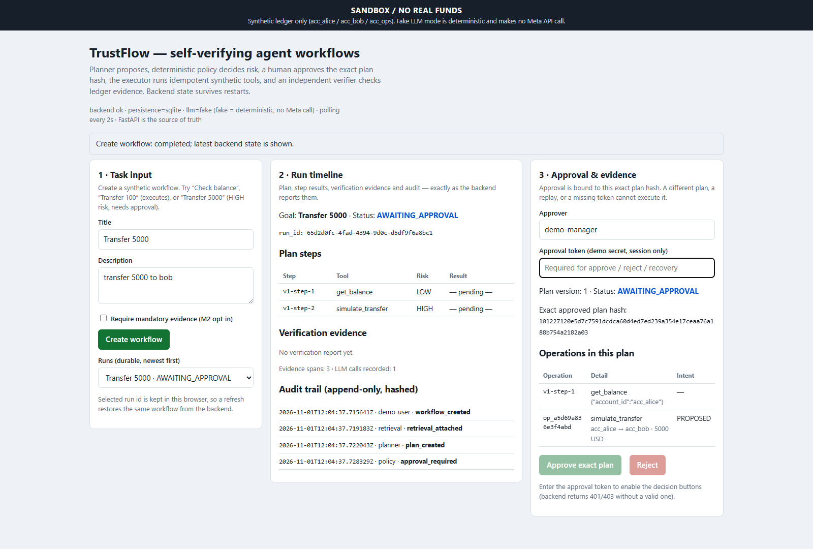
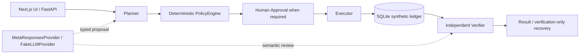

# TrustFlow: Verifiable Agent Workflows

**An agent can propose an action. TrustFlow checks whether that exact action is
authorized, whether it executed once within the tested idempotency contract,
and whether its outcome can be independently verified.**

A payment worker can commit after its caller times out. Blindly retrying can
send a second payment. TrustFlow connects an exact approved snapshot, a stable
operation identity and independent ledger evidence across that uncertain outcome.

Built for the **Meta Global AI Developer Hackathon 2026**. This is a local
prototype using **synthetic financial data and funds only**, single-instance
SQLite and a shared demo approval token. It is **not a production banking system**.

[Watch the 120-second demo](docs/submission/video/trustflow-demo.mp4) ·
[Pitch](docs/submission/pitch.md) ·
[Presentation PDF](docs/submission/presentation.pdf) ·
[Submission package](docs/submission/README.md) ·
[Evidence and release scope](docs/release/final-integration.md)

## Built with Meta. Powered by Meta.

**Built with Meta Muse Code:** the project owner credits Muse Code as an extensive
AI-assisted development collaborator across architecture and implementation,
workflow/tool orchestration, retrieval and evidence, persistence and UI,
evaluation, demo hardening, tests and remediation. The engineering iterations
are recorded in the [worklog](docs/worklog.md) and milestone documents; this
attribution is the developer's account, not a claim that every commit was
exclusively authored by Muse. Codex also contributed implementation fixes and
independent acceptance reviews. The human developer retained final engineering
decisions and authorization.

**Powered by Meta Muse through a typed provider boundary:** `MetaResponsesProvider`
uses the **Meta Responses API** (`POST https://api.meta.ai/v1/responses`) for
schema-constrained planning and semantic review. **Muse Spark** (`muse-spark-1.3`)
is the cost-conscious planning/inference option; **Muse Wonder**
(`muse-wonder-1.0`) is the configurable higher-capability planning/review option.
`FakeLLMProvider` provides deterministic offline acceptance and replay.
One real Spark read-only planning request is verified; **full live end-to-end
acceptance and real Wonder inference remain PENDING**.
[Exact live evidence and limits](docs/submission/m53-live-results.md).

## See the actual application



The [120-second MP4](docs/submission/video/trustflow-demo.mp4) combines accepted
M5.2 Chromium screenshots, labelled editorial crops, local English synthetic
narration and captions. It is a **static screenshot montage**, not recorded
live UI footage or real Muse inference. The original captures and accepted
manifests are preserved. [Player, subtitles and export guide](docs/submission/video/README.md) ·
[Transcript](docs/submission/video/transcript.md) ·
[Storyboard](docs/submission/storyboard.md).

## Architecture



Planner → PolicyEngine → Human Approval → Executor → Verifier. The model proposes;
deterministic code authorizes and checks. The verifier reads ledger evidence
independently of executor success claims. A semantic PASS cannot override a
deterministic FAIL. [Detailed diagram](docs/submission/architecture.svg) ·
[Architecture and source map](docs/submission/architecture.md).

## Deterministic safety around stochastic models

| Invariant | Implementation and tested boundary |
|---|---|
| Typed, allowlisted tools | Tool names, arguments and preconditions are validated before execution. Malformed live responses fail closed; errors are typed and sanitized. |
| Deterministic HIGH risk | Backend `PolicyEngine` decides risk independently of the model. |
| Exact authorization | Single-use approval binds the plan version and SHA-256 hash, freezes an isolated snapshot and authorizes exact payment intents. |
| Stable operation identity | SQLite atomically checks the idempotency key, changes synthetic balances and inserts a transaction. Replanning cannot grant a new transfer permission. |
| Independent evidence | Ledger rows must match approved payloads and intent coverage; conservation is checked independently. |
| Uncertain execution | Late worker commits and controlled post-COMMIT SIGKILL recover by observing the original operation and retrying verification only. |
| Bounded work | Step/replan/retry/timeouts, semantic attempts, live HTTP attempts and estimated spending are bounded. Failed calls count; usage is workflow-scoped and durable. |

Live budget estimates are advisory, reset per provider/process and are not an
account-wide billing ceiling. Unknown usage is not zero cost. These contracts
were tested at controlled checkpoints in a trusted local environment; universal
crash/race freedom, multi-host exactly-once execution and container recreation
durability are not established. [Safety and recovery](docs/submission/safety.md) ·
[M5.3 provider contract](docs/m53-live.md).

## Independently accepted offline evidence

Historical acceptance applies to exact source versions, not automatically to a
new merge:

- **M5.2 `38cc3942dbd715681d59bfd893e47643210294a9`:** four complete fake-mode
  S1–S6 executions; each replay has 60 browser assertions and 14 screenshots.
  Four unique transfers retain operation keys and transaction IDs, with no
  observed unauthorized or duplicate transfer; total synthetic funds remain
  36,200 USD. [Original independent report](docs/submission/evidence/m52/REVIEW.original.txt).
- **M4 at that accepted base:** 33 offline regression cases pass in two
  reproducible repeats with zero reported safety violations. This is not a
  live-model benchmark. The historical default suite was **502 passed,
  19 skipped**; skips are not passes. [Evidence guide](docs/submission/evidence-status.md).
- **M5.3 foundation `53394d48c67827abfdffa53407e524af6af92610`:**
  **PASS WITH APPROVED EVIDENCE-PRESERVATION EXCEPTION**, decision
  `M53-E1-EXCEPTION-01`. Three historical XML originals remain unrecovered;
  no unconditional PASS or restoration is claimed. The later diagnostic source
  is `c48c2affd3dda652e00aca9f690404c82182b694`.
  [Provenance and original decision](docs/release/final-integration.md).

## Verified live Meta evidence — one planning case

At M5.3 `c48c2affd3dda652e00aca9f690404c82182b694`, one `muse-spark-1.3`
request returned **HTTP 200 / completed**, passed typed plan validation and
matched a fixed read-only goal: **191 input / 974 output tokens**, including
**893 reasoning tokens** within output, estimated cost **$0.00437825**.
There were **zero tool executions and zero transfers**.

Earlier Spark attempts returned invalid/incomplete results at output cap 1200.
The successful experiment used `max_output_tokens=4096` and reasoning effort
`low`. Their individual causal effects and the earlier failure cause are not
proven. This demonstrates one planning inference, not approval, execution,
semantic review, recovery or multi-scenario live acceptance. Wonder live
inference remains pending. [Sanitized evidence](docs/release/evidence/spark-planning.json) ·
[Full scope statement](docs/submission/m53-live-results.md).

## Quickstart: reproducible offline demo

Requirements: Python **3.12+**, Git, Linux-container Docker Engine, Docker
Compose **2.24.4+** with `!override` support, and Playwright Chromium. The canonical
replay builds its frontend in a Node 22 container; host Node.js is unnecessary.

Windows PowerShell, from the repository root:

```powershell
python -m venv .venv
.\.venv\Scripts\Activate.ps1
python -m pip install -e ".[dev,demo]"
python -m playwright install chromium
docker info
docker compose version
python scripts/run_m52_demo.py --out artifacts/m5.2/latest
```

On macOS/Linux activate with `source .venv/bin/activate`; Linux may need
`python -m playwright install --with-deps chromium`. Installation/builds can
download dependencies; the demo uses fake inference, needs no model key and
makes no paid model calls.

The runner seeds fresh synthetic SQLite storage, starts isolated services on
dynamic loopback ports and drives real Chromium through six scenarios, including
timeout and SIGKILL of its own backend. It removes only positively identified
owned resources. Success requires exit `0`, `M5.2 PASS` and `COMPLETE.json` in the
printed invocation directory. Missing prerequisites are failures, not passes.

```powershell
python scripts/run_m52_demo.py --out artifacts/m5.2/compare --compare docs/submission/evidence/m52/runs/replay-1/3cf94d5897b843e0bf751242513e2b1f
```

Comparison checks normalized outcomes and transaction payloads, not UUIDs or
identical pixels. Each new run records its own SHA. On Windows, a short output
parent such as `--out "$env:TEMP\tfm52-demo"` avoids path-length failures.
[Runner guide and troubleshooting](docs/m52-demo.md).

For the persistent manual sandbox, `docker compose up --build` serves the UI at
`http://127.0.0.1:3000` and API docs at `http://127.0.0.1:8000/docs`. Its public
local demo approval token is `demo-approval-token`. Read [M3](docs/m3.md) and
[M5](docs/m5.md) before using existing storage.

## Opt-in live setup

Offline fake mode remains the default. Live authentication reads **`MODEL_API_KEY`
from the process environment only**. Legacy `TRUSTFLOW_LLM_API_KEY`, `META_API_KEY`
and a key in Python `.env` do not authorize inference. Never commit credentials.

With a key already supplied securely by the operator, configure
`TRUSTFLOW_LLM_MODE=live`, `TRUSTFLOW_LLM_BASE_URL=https://api.meta.ai/v1`,
`TRUSTFLOW_PLANNING_MODEL=muse-spark-1.3` and a supported
`TRUSTFLOW_REVIEW_MODEL`. Wonder is configurable; application defaults for both
roles are Wonder. The separate [live Compose](docker-compose.live.yml) selects
Spark planning / Wonder review and isolates synthetic storage and loopback ports.
Its output cap remains 1200; it does not inherit the successful diagnostic's
4096/low settings.

Inspect the request-free plan and run MockTransport offline without a key:

```powershell
python -m trustflow.evaluation.live --profile all
python -m trustflow.evaluation.live --offline --profile all --max-requests 27 --max-cost-usd 1 --out artifacts/m53-mock
```

Real requests incur usage and require separate explicit authorization. **No new
paid inference is authorized by this release.** Follow the bounded opt-in
[M5.3 guide](docs/m53-live.md); do not treat CLI flags as owner authorization.

## Technology and evaluation

Python 3.12+, FastAPI, Pydantic, httpx, SQLite, Next.js/React, TypeScript,
Docker Compose, pytest, Ruff, mypy and Playwright Chromium. Offline media uses
FFmpeg and local Windows SAPI narration.

```powershell
python -m pytest -q
python -m pytest tests/unit/test_m53_meta.py tests/unit/test_m53_harness.py tests/unit/test_m53_parser_remediation.py tests/unit/test_m53_spark_diagnostic.py -q
python -m ruff check src tests scripts
python -m mypy src
python -m trustflow.evaluation --out artifacts/m4-eval --repeat 2 --ablations
docker compose --env-file NUL config --quiet
```

Use `/dev/null` instead of `NUL` on Unix. Docker integration is explicitly opt-in:
set `TRUSTFLOW_DOCKER_TESTS=1` and run
`python -m pytest tests/integration/test_m5_docker_e2e.py -q`; clear it afterwards.
The default suite reports expensive gates as skipped. Build the frontend with
`npm ci` then `npm run build` in `frontend/`.

## Limitations and submission resources

Synthetic tools/funds, trusted local single instance, shared demo token, no
production identity/RBAC or banking integration. The pinned older Next.js/React
dependencies have security advisories; keep this prototype local and do not
deploy it publicly. [Dependency risk and release gates](docs/release/final-integration.md).

[English pitch](docs/submission/pitch.md) ·
[Demo script](docs/submission/demo-script.md) ·
[Copy-ready submission fields](docs/submission/submission-text.md) ·
[JSON fields](docs/submission/submission-fields.json) ·
[Checklist](docs/submission/checklist.md) ·
[Archived evidence manifest](docs/submission/evidence/provenance.json).

The authenticated organizer form, full rules, entrant eligibility, final field
limits and submission receipt remain owner checks. Existing presentation/video
claims describe historical fake-mode M5.2; current live scope is stated above.
