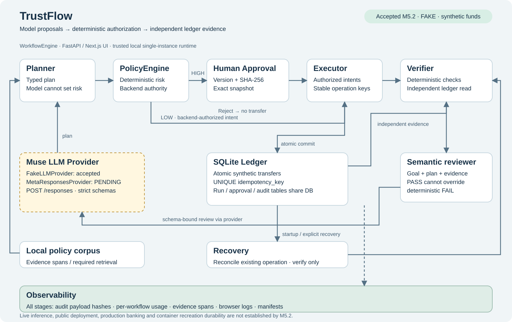

# TrustFlow

**Agent workflows with approvals you can bind and outcomes you can verify.**

TrustFlow turns a natural-language task into a typed plan, applies deterministic
risk policy, pauses for human approval where required, executes synthetic tools,
and checks the result against an independently read ledger. The difficult case is
a payment that commits just before the worker times out or the process dies:
TrustFlow preserves the operation's identity and recovers through verification.

Prepared for the **Meta Global AI Developer Hackathon 2026**. This is a local
research prototype using synthetic accounts and funds. The independently accepted
demonstration uses `FakeLLMProvider`; **live Meta inference results are pending**.
There is no real banking integration or public deployment.

[Project pitch](docs/submission/pitch.md) ·
[Two-minute demo](docs/submission/demo-script.md) ·
[Storyboard](docs/submission/storyboard.md) ·
[Presentation PDF](docs/submission/presentation.pdf) ·
[Submission checklist](docs/submission/checklist.md)

## See the accepted demonstration


This unedited Chromium capture comes from the independent M5.2 acceptance replay,
not a mockup or live-model session. The [evidence guide](docs/submission/evidence-status.md)
identifies the accepted SHA, scenario results, raw evidence and limitations.

## Setup

Requirements: Python **3.12+**, Git, a running Linux-container Docker Engine
(Docker Desktop on Windows), Docker Compose **2.24.4+** with `!override` support,
and Playwright Chromium. Host Node.js is unnecessary for the canonical replay:
the frontend builds in a Node 22 container.

From the repository root in Windows PowerShell:

```powershell
python -m venv .venv
.\.venv\Scripts\Activate.ps1
python -m pip install -e ".[dev,demo]"
python -m playwright install chromium
docker info
docker compose version
```

On macOS/Linux, activate with `source .venv/bin/activate`. On Linux, install
missing browser system libraries with `python -m playwright install --with-deps chromium`.
Dependency installation and initial Docker builds can use the network. The
demonstrated workflow uses fake inference, needs no model key and makes no paid
model calls. Do not put credentials in demo output directories.

## One-command reproducible demo

After setup, with the virtual environment active:

```powershell
python scripts/run_m52_demo.py --out artifacts/m5.2/latest
```

The runner starts isolated FastAPI and Next.js services on dynamic loopback
ports, seeds fresh synthetic SQLite storage, drives real headless Chromium and
checks six scenarios. No manual clicks are needed. It performs controlled fault
injection, including a timeout and SIGKILL of its own backend, and removes its
positively identified resources when finished. This command starts Docker
workloads; it is not a read-only viewer. No Docker workload was run to assemble
this documentation package.

Success requires exit code `0`, `M5.2 PASS` and a `COMPLETE.json` inside the printed
invocation directory. Missing Docker/Chromium is a failure, not a passing skip.
Each invocation has a unique child directory; `latest` is only its parent.

Compare a fresh run with the included accepted replay:

```powershell
python scripts/run_m52_demo.py --out artifacts/m5.2/compare --compare docs/submission/evidence/m52/runs/replay-1/3cf94d5897b843e0bf751242513e2b1f
```

Comparison covers normalized outcomes and transaction payloads, not identical
pixels or volatile UUIDs. Raw snapshot and approval hashes are checked within
each run. A run on this documentation branch records its own current SHA; the
archived acceptance applies to `38cc3942dbd715681d59bfd893e47643210294a9`.

For Windows path-length failures, use a short output parent, for example
`python scripts/run_m52_demo.py --out "$env:TEMP\tfm52-demo"`. See the
[accepted runner guide](docs/m52-demo.md) for scenarios, troubleshooting,
resource ownership checks and failure artifacts. Preserve failed attempts and
inspect `FAILED_ATTEMPT.json`; do not use global Docker cleanup commands.

## Architecture



The `WorkflowEngine` coordinates Planner → PolicyEngine → Human Approval when
required → Executor → Verifier. SQLite stores runs, approvals, synthetic ledger
transactions and audit events. Deterministic verification has priority over the
semantic reviewer. Audit events, evidence spans, usage records and replay
manifests make the decision and outcome inspectable.

The provider boundary supports deterministic fake output and the existing
`MetaResponsesProvider`. The latter sends schema-constrained requests to
`POST /responses`; planning and review default to `muse-wonder-1.0` in the accepted
source. Its presence is an implementation fact, not proof of live compatibility
or model performance. [Architecture and source map](docs/submission/architecture.md).

## Safety guarantees and tested scope

| Contract | What the accepted local experiment demonstrates |
|---|---|
| Backend authorization | `PolicyEngine` decides risk; HIGH-risk execution waits for an authenticated, single-use decision matching the plan version and SHA-256 hash. |
| Exact approved snapshot | Approval deep-copies the plan and authorizes its payment intents. Execution checks operation identity and authorized payload at the mutation boundary. |
| Idempotency | Stable intent/operation keys identify a logical transfer. SQLite atomically checks the key, changes balances and inserts a transaction; duplicate keys cannot create another matching transfer. |
| Evidence grounding | Deterministic checks read the ledger independently of tool success claims, match payloads and intent coverage, and check conservation. A semantic PASS cannot override deterministic FAIL. |
| Uncertain outcomes | A timed-out thread can still commit. Recovery observes the original operation and uses verification-only retry instead of issuing another transfer. |
| Bounded work | Step/re-plan/retry and semantic-attempt limits constrain the workflow; usage is tracked per workflow. Fake runs do not establish live costs or latency. |

These contracts were exercised at controlled checkpoints in a trusted local,
single-instance SQLite environment. They do not establish universal crash/race
freedom, container recreation durability, multi-host guarantees, production
banking readiness or tenant isolation. The shared local approval token is not
production authentication/RBAC. [Safety and recovery](docs/submission/safety.md).

## Evidence, not inferred model scores

The [independent M5.2 report](docs/submission/evidence/m52/REVIEW.original.txt)
accepts exact commit `38cc3942dbd715681d59bfd893e47643210294a9`:

- S1–S6 passed in four complete fake-mode executions, including two canonical
  replays with independent read-only SQLite observations and two maintained
  opt-in replays. Each has 60 browser assertions and 14 screenshots.
- Per canonical replay, four unique transfers retain their original operation
  keys and `tx_id` values. No duplicate or unauthorized transfer was observed;
  the synthetic total stayed at 36,200 USD.
- The separate 33-case offline M4 regression evaluation passed all cases in
  two reproducible repeats, with zero reported safety violations. This is a
  workflow regression result, not a live-model benchmark.

The default suite in that report was **502 passed, 19 skipped**; skipped tests
are not executed passes. See [accepted results and boundaries](docs/submission/evidence-status.md).
These are historical independent results, not tests rerun during M5.4 packaging.

## Meta Muse integration

Muse is relevant to two language tasks: proposing a structured plan and reviewing
goal/plan/evidence alignment. Meta documents Muse Wonder and Muse Spark for
agentic work, including tool calling and structured output.
[Meta model documentation](https://dev.meta.ai/docs/models).

TrustFlow keeps authorization, operation identity and ledger checks in
deterministic code so a model proposal cannot grant itself permission. Live
schema acceptance, model quality, failed-attempt accounting and budget behavior
still require an explicitly authorized, independently supported M5.3 experiment.
[M5.3 evidence template — pending](docs/submission/m53-live-results.md).

## Development and offline checks

With dependencies installed, from the repository root:

```powershell
python -m pytest -q
python -m ruff check src tests scripts
python -m mypy src
python -m trustflow.evaluation --out artifacts/m4-eval --repeat 2 --ablations
```

The default pytest suite leaves expensive Docker gates opt-in. For a manual UI,
`docker compose up --build` starts the local sandbox at
`http://127.0.0.1:3000` with API docs at `http://127.0.0.1:8000/docs`; it uses
persistent demo storage and is distinct from the fresh, scripted replay. See
[M3](docs/m3.md) and [M5](docs/m5.md) before using existing local storage.

[Package index](docs/submission/README.md) ·
[Provenance manifest](docs/submission/evidence/provenance.json) ·
[Original accepted README](docs/submission/evidence/m52/README.m52-original.txt)
