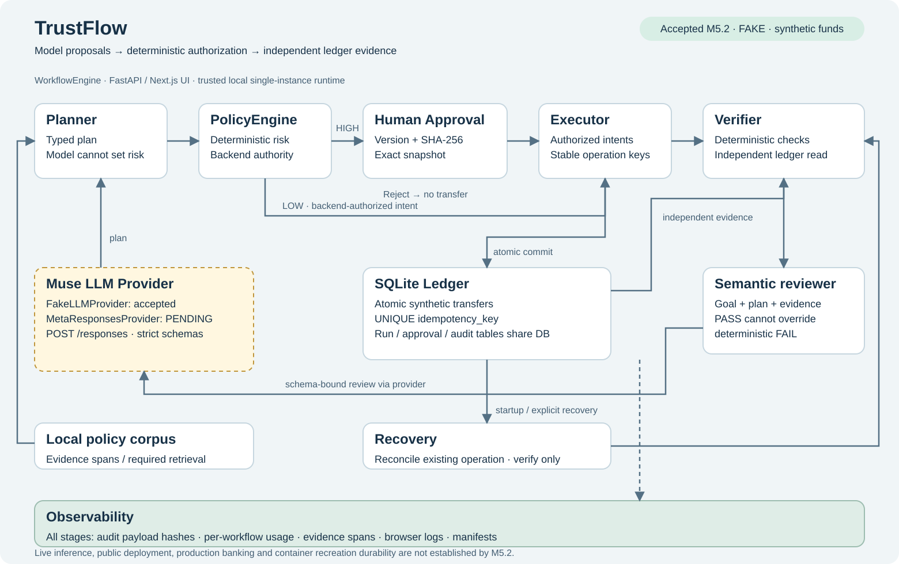

# Architecture and implementation map

[Editable Mermaid source](architecture.mmd). Solid paths show the implemented
workflow; the dashed live-provider path marks pending live evidence. The diagram
describes orchestration, not a distributed service deployment. Ledger, runs,
approvals and audit tables share local SQLite persistence.

| Component | Responsibility | Source |
|---|---|---|
| Planner | Natural-language goal to typed plan; does not decide final risk | [planner.py](../../src/trustflow/agents/planner.py) |
| Muse LLM Provider | Structured proposals and semantic review; fake for accepted replay, Meta adapter for future live validation | [provider.py](../../src/trustflow/llm/provider.py) |
| PolicyEngine | Deterministic tool/payload risk and approval requirement | [policy_engine.py](../../src/trustflow/policies/policy_engine.py) |
| Human Approval | Token gate at API; single decision tied to version/hash; isolated approved snapshot | [approval.py](../../src/trustflow/agents/approval.py), [app.py](../../src/trustflow/api/app.py) |
| Executor | Allowlisted typed tools, authorized payload checks, stable operation keys, timeout/late-worker tracking | [executor.py](../../src/trustflow/agents/executor.py), [registry.py](../../src/trustflow/tools/registry.py) |
| SQLite Ledger | Atomic synthetic balance/transaction changes; unique idempotency keys | [ledger.py](../../src/trustflow/persistence/ledger.py) |
| Verifier | Independent ledger match, intent coverage and conservation; deterministic checks first | [verifier.py](../../src/trustflow/agents/verifier.py), [semantic.py](../../src/trustflow/agents/semantic.py) |
| Recovery | Startup reconciliation and explicit verification-only retry | [recovery.py](../../src/trustflow/persistence/recovery.py), [engine.py](../../src/trustflow/orchestration/engine.py) |
| Observability | Hashed audit payloads, per-workflow usage, evidence spans and browser/replay manifests | [logger.py](../../src/trustflow/audit/logger.py), [usage.py](../../src/trustflow/llm/usage.py), [evidence.py](../../scripts/m52/evidence.py) |

## Provider contract and validation boundary

`FakeLLMProvider` is deterministic, offline and used by all accepted M5.2
screenshots. `MetaResponsesProvider` exists in the same accepted source and sends
`POST {base}/responses` with `text.format` containing a strict JSON schema.
`PLAN_SCHEMA` and `REVIEW_SCHEMA` are flat/non-recursive; the model returns data
which local code validates and maps to registered tools. This flow does not
claim native remote tool execution or Meta-hosted storage.

Meta documents schema-constrained outputs, including `text.format` for Responses.
That documentation supports the integration design; only an actual live run can
prove this adapter and these schemas work with the selected model.
[Official structured-output documentation](https://dev.meta.ai/docs/structured-output).

| Setting in accepted source | Value / meaning |
|---|---|
| `TRUSTFLOW_LLM_MODE` | Default `fake`; explicit `live` selects Meta provider |
| `TRUSTFLOW_LLM_BASE_URL` | Default `https://api.meta.ai/v1` |
| `TRUSTFLOW_PLANNING_MODEL` / `TRUSTFLOW_REVIEW_MODEL` | Default `muse-wonder-1.0` |
| `TRUSTFLOW_FAST_MODEL` | Default `muse-spark-1.3`; configured value, not proof of a call |
| `MODEL_API_KEY` | Preferred key source; legacy fallback `TRUSTFLOW_LLM_API_KEY` |
| `TRUSTFLOW_LLM_MAX_RETRIES` | Default 2; total transport attempts 3 |
| `TRUSTFLOW_SEMANTIC_MAX_ATTEMPTS` | Default 3 including initial review |

This is a configuration inventory, not a command to enable live mode. No key or
live request is needed to view or reproduce the fake-mode submission. Actual
model availability, protocol/schema acceptance, usage and quality remain
[pending M5.3](m53-live-results.md).
